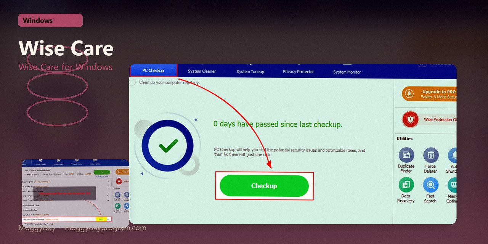
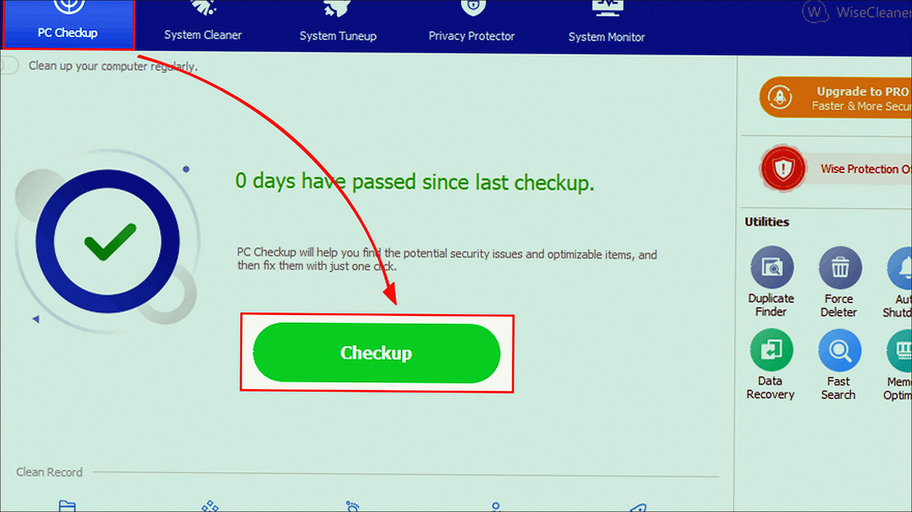
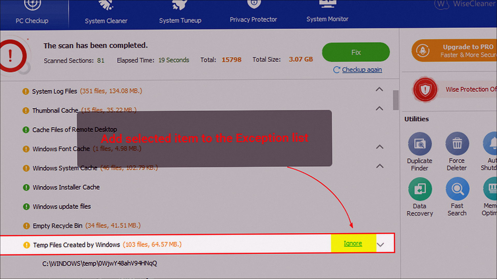
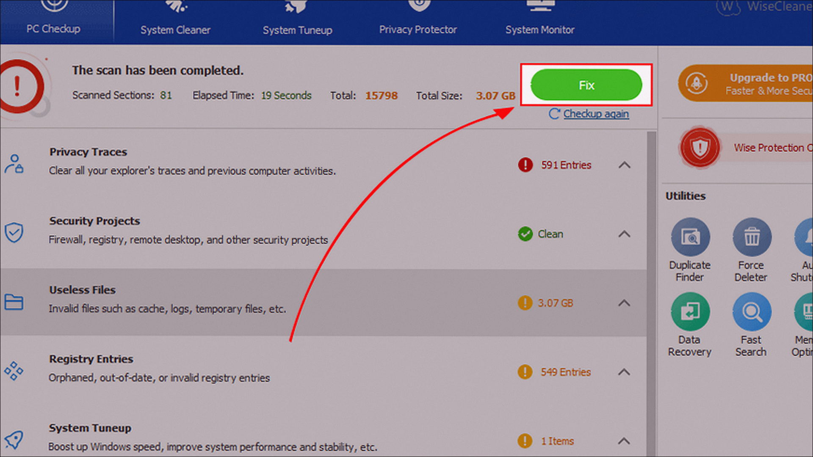

# Wise Care 8.0.6.734

Wise Care 365 on Windows 10/11 x64. 31 MB. Requirements, screenshots, MoggyDay Launcher.

Site: [EN](https://moggydayprogram.com/en/programs/wise-care-365) · [RU](https://moggydayprogram.com/programs/wise-care-365) · [Pages](https://cavernwithinshow.github.io/wise-care-365-windows/)

  

  
  
  

## Wise Care for Windows

- Size: 31 MB
- Updated: 15 Oct 2026
- Windows 10/11 x64

## Links

- https://moggydayprogram.com/en/programs/wise-care-365
- https://moggydayprogram.com/programs/wise-care-365
- https://moggydayprogram.com/categories/utilities

Also: 
- [Glary Utilities](https://moggydayprogram.com/programs/glary-utilities)
- [Ashampoo WinOptimizer](https://moggydayprogram.com/programs/ashampoo-winoptimizer)

Pages: https://cavernwithinshow.github.io/wise-care-365-windows/
